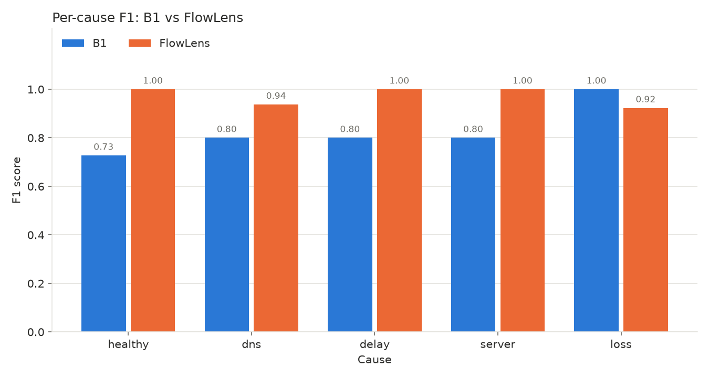
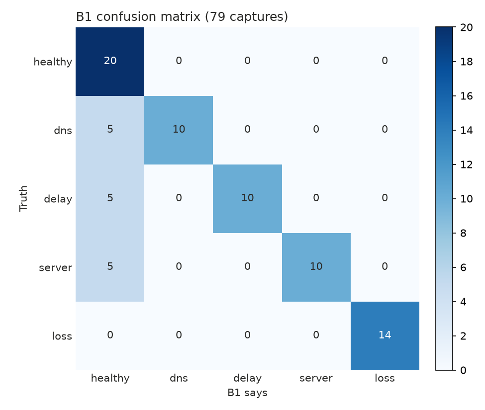
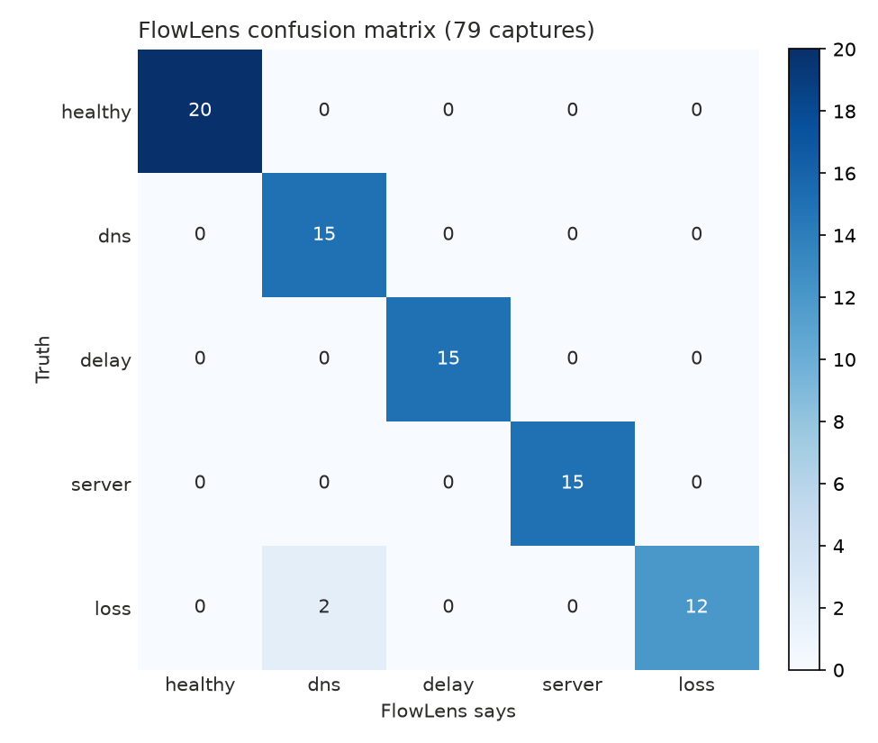
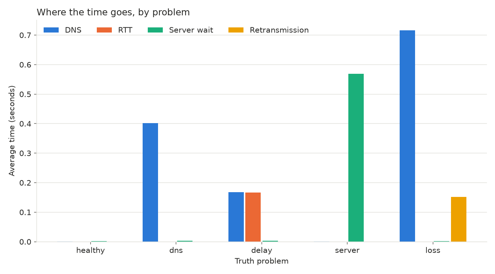

# Preliminary Results

These are preliminary results from a small pilot set.
We used it to check that the lab, the measurements and the evaluation work from end to end.
The final evaluation will use separate experiment sets.

## Pilot set

All captures were made in our lab.
The lab has two Linux network namespaces, a client (10.0.0.1) and a server (10.0.0.2), joined by a virtual Ethernet link.
The server namespace runs our own DNS server and web server, and each can add a set reply delay.
The client resolves `site.lab` and downloads a page with `curl`, while `tcpdump` records DNS and HTTP traffic on the client side.
Each capture has exactly one injected problem, and that problem is saved in an answer file as the ground truth.

| Problem | How it is injected                       | Low    | Medium | High    |
|---------|------------------------------------------|-------:|-------:|--------:|
| dns     | DNS server waits before replying         | 100 ms | 300 ms | 800 ms  |
| delay   | `netem` delay on the server link         | 50 ms  | 150 ms | 300 ms  |
| server  | web server waits before responding       | 200 ms | 500 ms | 1000 ms |
| loss    | `netem` packet loss on the server link   | 1%     | 5%     | 10%     |

The pilot set has 80 captures: 20 healthy and 60 faulty.
The faulty part is 4 problems × 3 severities × 5 repeats, recorded in random order.
Healthy, DNS, delay and server runs download a 10 KB page.
Loss runs download a 5 MB file, so that packets are actually dropped.
One loss capture (run0041) is left out because no packet was lost in it, which leaves 79 scored captures.

Both methods receive the same per-transaction measurements: DNS time, RTT, server wait, retransmission count and time, and SYN retransmissions.
**B1** is a rule-based baseline with fixed limits: DNS > 200 ms, RTT > 100 ms, server wait > 300 ms, or any retransmission.
**FlowLens** learns the median and spread (MAD) of each measurement from the healthy captures and flags any value with a robust z-score above 3.5.
The cause responsible for the largest share of the time is the diagnosis.

## B1 vs FlowLens

**Table 1.** Results on the 79 pilot captures. CIs are 95% Wilson intervals.

| Method   | Top-1 accuracy | 95% CI        | False alarms | 95% CI   | F1 healthy | F1 dns | F1 delay | F1 server | F1 loss |
|----------|---------------:|--------------:|-------------:|---------:|-----------:|-------:|---------:|----------:|--------:|
| B1       | 81.0% (64/79)  | 71.0 – 88.1%  | 0/20         | 0 – 16.1%| 0.73       | 0.80   | 0.80     | 0.80      | 1.00    |
| FlowLens | 97.5% (77/79)  | 91.2 – 99.3%  | 0/20         | 0 – 16.1%| 1.00       | 0.94   | 1.00     | 1.00      | 0.92    |

FlowLens was right on 15 captures where B1 was wrong, and B1 was right on 2 where FlowLens was wrong.
Neither method was wrong on any capture where the other was also wrong.
McNemar's exact test gives p = 0.0023, so the difference is statistically significant on this set.

**Figure 1.** F1 score per cause.
FlowLens scores higher than B1 for healthy, DNS, delay and server.
B1 scores higher only for loss.

**Figure 2.** Confusion matrices for B1 (top) and FlowLens (bottom). Rows are the true cause and columns are the diagnosis.
B1 labels 5 DNS, 5 delay and 5 server runs as healthy.
FlowLens makes only 2 errors, both loss runs it labels as DNS.

**Figure 3.** Average time in each part of the visit, for each true problem.
Each fault adds time to the part we expected it to affect.
In delay runs, the DNS time also grows, because the DNS reply crosses the same delayed link.

## Error analysis

**B1 misses mild faults.**
All 15 of B1's errors are low-severity runs: 100 ms DNS, 50 ms RTT or 200 ms server wait.
B1 called every one of them healthy.
These values are under B1's fixed limits of 200 ms, 100 ms and 300 ms.
They are still 50 to 100 times slower than normal, since a healthy visit in the lab has under 1 ms of DNS and about 2 ms of server wait.
FlowLens compares each value with the healthy range instead of a fixed number, so these faults stand out clearly.
It detected all medium and high runs as well.

**FlowLens confuses loss that hits DNS (run0030, run0060).**
In these two loss runs, the injected loss also dropped the client's DNS query.
The client waited the 5-second resolver timeout and asked again, so DNS took 5.0 s of a 5.0–6.0 s visit.
FlowLens names the step that took the most time, so it reported DNS.
The real cause was packet loss.
B1 got these two right only because it flags any retransmission as loss.
A possible fix is to treat a DNS time close to the resolver timeout as evidence of loss, not of a slow DNS server.

## Limitations

- **Small set.** 79 captures and 20 healthy runs give wide confidence intervals. The false-alarm rate is 0/20, but the true rate could still be as high as 16%.
- **Same data for fitting and testing.** FlowLens learned its healthy range from the same 20 healthy captures it was then scored on. This favours FlowLens on the healthy runs. The final evaluation will learn the reference from one set and test on another.
- **Clean lab.** There is one client, one server, no background traffic and one problem at a time. Real networks are noisier, and the healthy range will be wider there.
- **Limits not tuned.** Neither B1's limits nor FlowLens's z-limit of 3.5 were tuned on this set. Results may change with other settings.
- **Loss that hits DNS** is a known blind spot (see the error analysis).

Because of these points, the pilot numbers are preliminary results only.
They show that the pipeline works and that FlowLens looks promising.
They are not the final results.
The final evaluation will use separate experiment sets.
